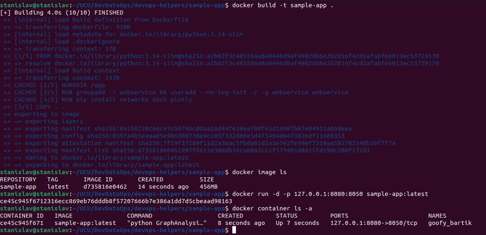
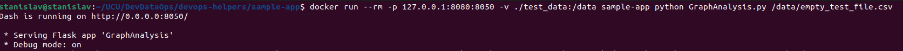
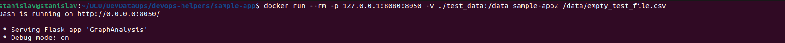
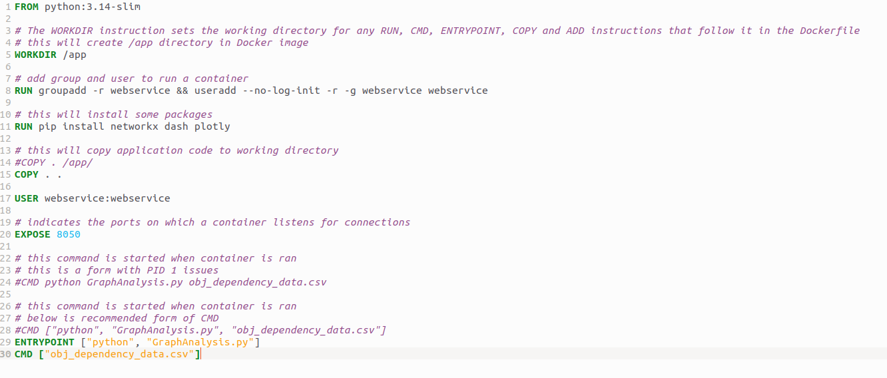
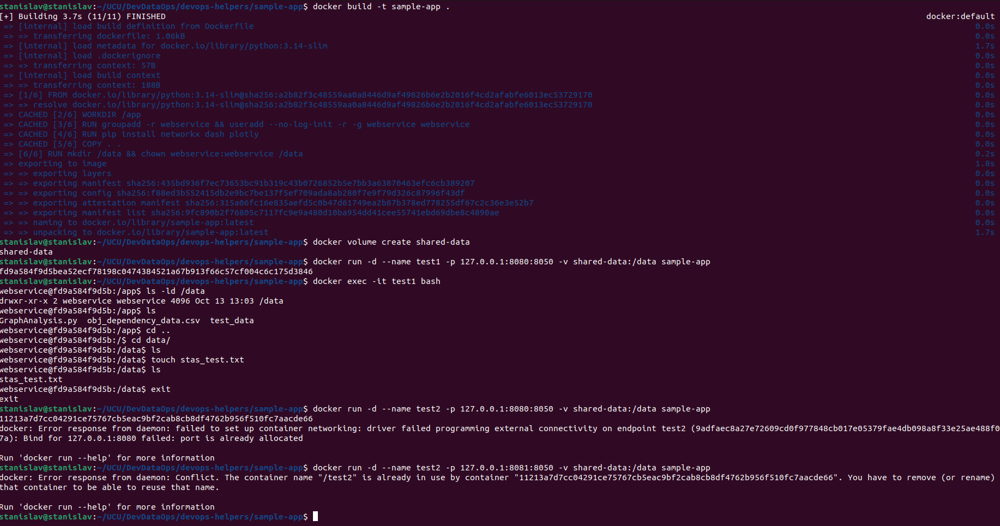
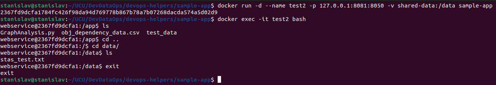
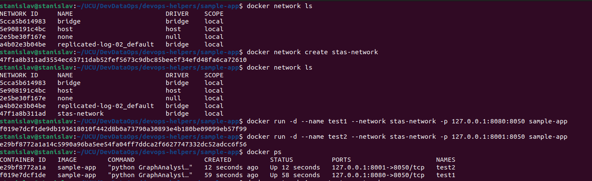
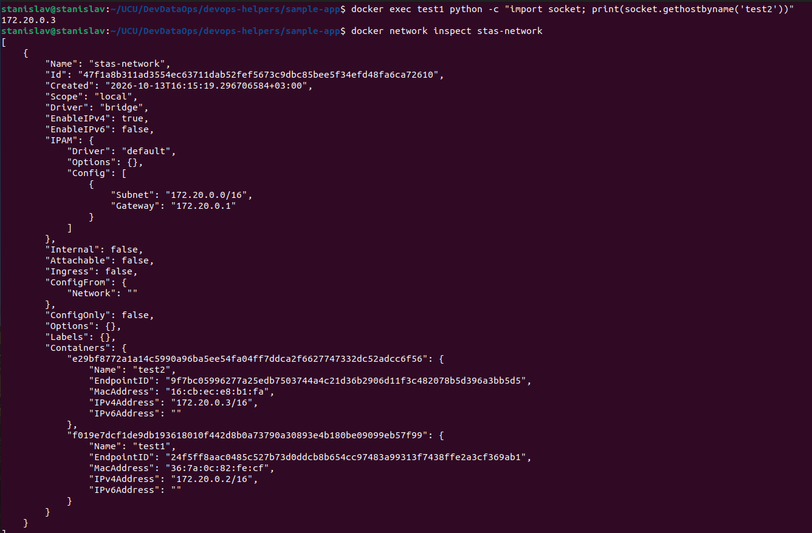
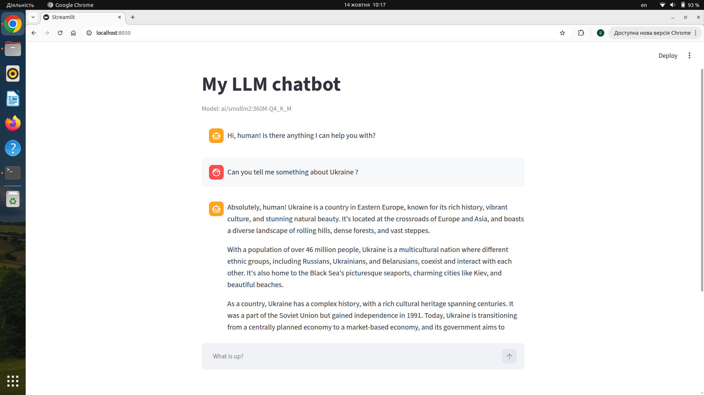
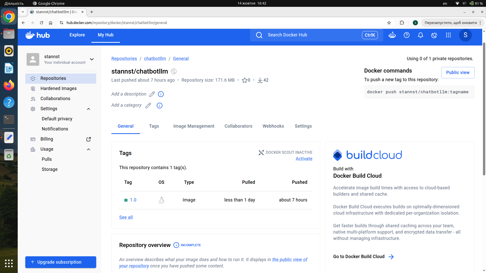

## Docker Homework

### Task 4 - Run Sample Application in docker container



---

### Task 5 - Visualize another data file with Sample application (use bind mounts & endpoint & cmd combination)







---

### Task 6 - Run any application with 2 containers with volume and prove data sharing





---

### Task 7 - Run 2 containers in the same network and prove communication





---

### Task 8 - Docker multistage build and LLM chatbot application

A Streamlit chatbot (web/web.py) talks to a local LLM served by Docker Model Runner. The web UI is exposed on port **8050**.

### Dockerfiles

1. **Dockerfile** - a regular build.
2. **Dockerfile_multistage** - a multi-stage build:
   - **Stage 1 (builder)** installs the Python dependencies into a virtual environment (/opt/venv).
   - **Stage 2 (runtime)** starts from a clean python:3.12-slim, copies only the ready virtual environment.

### Docker Compose

docker-compose.yml:
- **service1 (web)** - the Streamlit UI container, built from the Dockerfile (or Dockerfile_multistage) and published on port 8050.
- **service2 (llm)** - the LLM, run by Docker Model Runner (ai/smollm2:360M-Q4_K_M). Compose injects the model endpoint and name into `web` as the `LLM_URL` and `LLM_MODEL` environment variables, so the app does not hardcode any address.

### Requirements

- **Docker Compose v2.38+**
- **Docker Model Runner**

```bash
docker compose version
docker model version
```

### How to run

```bash
# build the image and start the stack
docker compose up --build -d (or without -d)

# check the containers and the model
docker compose ps
docker model list

# check the environment injected by Compose
docker compose exec web env | grep LLM_
```

Open the chatbot in the browser: **http://localhost:8050**

To stop the stack:

```bash
docker compose down

# optional: unload the model from memory
docker model unload --all
```



### Publishing the image to Docker Hub

**Link** https://hub.docker.com/r/stannst/chatbotllm/tags


