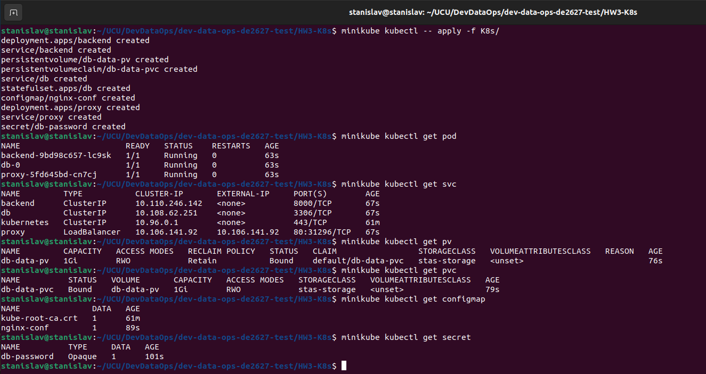
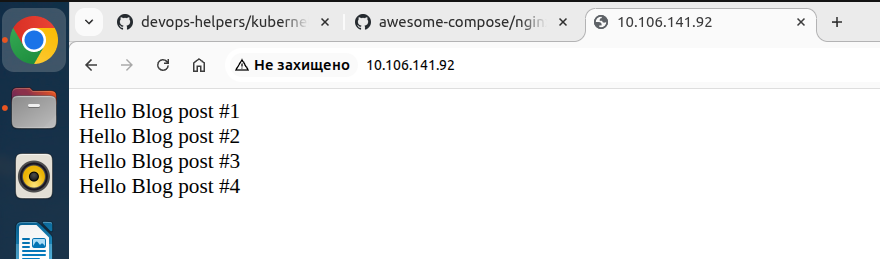

## Kubernetes (minikube) Homework

This Kubernetes project is based on the original Docker Compose sample:
https://github.com/docker/awesome-compose/tree/master/nginx-flask-mysql
(flask та mysql-connector in backend/requirments.txt were fixed)

### Overview

**backend** (Flask) flask-backend:stastest, built locally from the project in the link above - Deployment, Service (ClusterIP)

**db** (MariaDB) mariadb:10-focal, pulled from Docker Hub - StatefulSet, Service (ClusterIP), Secret, PV, PVC

**proxy** (Nginx) nginx:1.25-alpine, pulled from Docker Hub - Deployment, Service (LoadBalancer), ConfigMap (для підміни nginx.conf)

### Start

minikube kubectl apply -f K8s/
minikube tunnel # separate terminal

http://<EXTERNAL-IP of the proxy service>:80

### Stop

minikube kubectl -- delete -f K8s/

### Screenshots

**Running pods**

**Application UI** 

